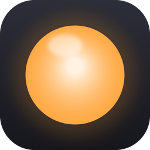

<p align="center">
  
</p>

<h1 align="center">Lume</h1>

<p align="center">
  A quick tray panel to control a Tuya RGB bulb (Smart Life, Positivo Casa Inteligente and other<br>
  Tuya-based brands) straight over your local network, no cloud involved.<br>
  Windows, Linux and macOS.
</p>

<p align="center"><a href="README.pt-BR.md">Leia em português</a></p>

- Click the tray icon (the menu bar icon on macOS) to open the panel: brightness, white temperature,
  colour presets and a colour wheel
- Mouse wheel and keyboard arrows work on the sliders
- Reconnects by itself when the lamp is switched off at the wall or gets a new IP
- Stays out of the taskbar and the Dock
- Follows the system language (English, Portuguese, Spanish, French, German, Italian, Japanese,
  Simplified Chinese)

## Download

Get the latest version from [Releases](https://github.com/onealhtml/lume/releases/latest):

| System | File |
|---|---|
| Windows 10/11 | `Lume-…-Windows-Setup.exe` |
| Linux | `Lume-…-Linux-x86_64.AppImage` (or the `.tar.gz`) |
| macOS, Apple Silicon (M1 and later) | `Lume-…-macOS-arm64.dmg` |
| macOS, Intel | `Lume-…-macOS-x86_64.dmg` |

What changed in each version is in the [changelog](CHANGELOG.md).

## Install

**Windows:** run the installer; it doesn't need administrator rights. Lume isn't signed with a paid
certificate, so SmartScreen may warn you: click *More info* → *Run anyway*.

**Linux:** make the AppImage executable and run it:

```
chmod +x Lume-*.AppImage
./Lume-*.AppImage
```

If it complains about FUSE, install `libfuse2` (Ubuntu: `sudo apt install libfuse2t64`) or run it with
`--appimage-extract-and-run`.

**macOS:** drag Lume into Applications. Lume isn't notarized by Apple, so the first time right-click it →
*Open* → *Open*. If macOS says the app is "damaged", run:

```
xattr -dr com.apple.quarantine /Applications/Lume.app
```

## Setup

The first time, Lume opens its settings. Click **Smart Life login**, then in the Smart Life app go to
Me › gear › Account and Security › User Code, paste the code, scan the QR code and click
**Save and connect**. The lamp has to be paired in Smart Life (or Tuya Smart).

**Start with the system** adds Lume to the right place on each system (the registry on Windows,
`~/.config/autostart` on Linux, a LaunchAgent on macOS).

### Notes per system

- **Windows 11:** the panel uses the system's acrylic glass, or a lighter blur (Settings › Glass).
- **Linux:** GNOME only shows tray icons with the *AppIndicator* extension (Ubuntu already ships it;
  KDE and most other desktops have a tray of their own). Without a tray, Lume opens as a regular
  window. On Wayland the system decides where windows appear. To get the icon in GNOME's top bar:

  ```
  sudo dnf install gnome-shell-extension-appindicator      # Fedora
  sudo apt install gnome-shell-extension-appindicator      # Debian
  sudo pacman -S gnome-shell-extension-appindicator        # Arch
  ```

  Log out and back in, then `gnome-extensions enable appindicatorsupport@rgcjonas.gmail.com` and
  open Lume again.
- **macOS:** the icon lives in the menu bar; "Quit Lume" is in Settings.

## Run from source

Requires Python 3.10 or newer.

```
python -m venv .venv
.venv/bin/pip install -r requirements.txt      # Windows: .venv\Scripts\pip
.venv/bin/python lume.pyw                      # Windows: .venv\Scripts\pythonw lume.pyw
```

| File | What it is |
|---|---|
| `lume.pyw` | the app: tray, window and the bridge to the interface |
| `ui/Main.qml` | the interface (Qt Quick) |
| `core.py` | settings, start with the system and the connection to the lamp |
| `i18n.py` | translations; the code is written in English |
| `smartlife_qr.py` | Smart Life QR login to get the local key |
| `platform_tweaks.py` | per-system tweaks (Windows glass, hiding from the macOS Dock) |
| `icons.py` | draws the tray icon in the lamp's colour; `python icons.py` rebuilds `assets/` |

`packaging/` has the PyInstaller spec, the Inno Setup script (Windows) and the AppImage (Linux) and
DMG (macOS) scripts. Pushing a `vX.Y.Z` tag runs `.github/workflows/release.yml`, which builds on all
three systems and publishes a Release with that version's section of the changelog.

Settings, including the lamp's local key, live outside the repository: `%APPDATA%\Lume` (Windows),
`~/.config/lume` (Linux) or `~/Library/Application Support/Lume` (macOS).
